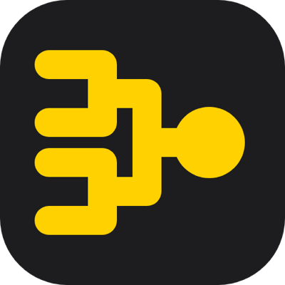

<p align="center"></p>

# Cupday MCP server

**Plan and run youth sports tournaments from your AI assistant.** Give it a team list (or paste an email from the clubs) and [Cupday](https://cupday.app) builds the whole schedule: groups, finals, pitches and kick-off times, with no team playing back to back. Then run game day from the same chat: enter scores, shift games when you are running late, move or swap games, rename teams. Parents follow live scores and tables on a public page, without an app or account.

- **Remote server:** `https://cupday.app/mcp` (Streamable HTTP)
- **Auth:** OAuth 2.1 with PKCE and dynamic client registration. Sign in with your email and a one-time code; no password, no API key.
- **Price:** free. Every feature, no paid plan.
- **Languages:** English, Finnish, Dutch, Swedish, German, Polish, Italian
- **Sports:** 20, including football, futsal, floorball, handball, basketball, volleyball and ice hockey
- **Docs:** https://cupday.app/docs/mcp · **Registry:** `app.cupday/cupday`

This repository only holds connection instructions and metadata. The server is hosted by Cupday; there is nothing to install or run.

## Tools

| Tool | What it does | Type |
|---|---|---|
| `plan_tournament` | Builds schedule options from a description and a team list. Saves nothing. | read-only |
| `create_tournament` | Publishes the tournament; returns the public page, a private organizer link, referee links and ready-to-send messages for parents, coaches and referees. | write |
| `get_tournament` | Schedule, results, tables and teams of a public tournament (optionally for one team). | read-only |
| `find_tournaments` | Searches upcoming public tournaments by name, country and date. | read-only |
| `edit_tournament` | Game-day changes with the organizer link: delay, move or swap games, rename teams, change details. | write |
| `record_result` | Enters or corrects a score with the organizer or referee link. | write |

## Connect

**Claude (claude.ai / Desktop):** Settings → Connectors → Add custom connector → URL `https://cupday.app/mcp`.

**ChatGPT:** Settings → Plugins → Add → Add custom MCP server → URL `https://cupday.app/mcp`, authentication OAuth.

**Claude Code:**
```bash
claude mcp add --transport http cupday https://cupday.app/mcp
```

**Cursor / VS Code / any MCP client** (`.mcp.json` / `mcp.json`):
```json
{ "mcpServers": { "cupday": { "type": "http", "url": "https://cupday.app/mcp" } } }
```

Your client opens a Cupday sign-in page the first time; enter your email and the 6-digit code.

## Try it

> Plan a U10 football cup for next Saturday, 9 to 13, on 2 pitches, for these teams: Riverside Blue, Riverside Red, Harbour FC, Hill Town, Northgate Youth, Oakfield Colts. Show me the options first.

> Option 2, publish it and give me the links.

> Harbour FC beat Hill Town 3-1. And we're running 15 minutes late on pitch 2 from 10:00.

## Privacy and support

Cupday stores only what a tournament needs: team names, clubs, schedules and results, never personal details about players. [Privacy policy](https://cupday.app/privacy) · [Terms](https://cupday.app/terms) · Support: support@cupday.app
